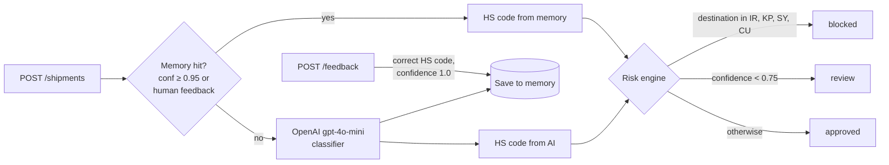

# Export Agent — AI-Assisted Export Compliance Engine

[](https://github.com/AdityaShekhawat0504/export-agent/actions/workflows/ci.yml)

**A FastAPI service that classifies export shipments into HS codes with an LLM, remembers human corrections, and returns an approve / review / block decision.**

## Problem

Every export shipment needs an HS (Harmonized System) tariff code and a sanctions
check before it can ship. Doing this by hand is slow and inconsistent, and pure-LLM
classification is not trustworthy enough to act on alone. Export Agent combines an
LLM classifier, a memory of human-verified answers, and explicit risk rules, and
routes uncertain cases to a human instead of guessing.

## How it works



1. A shipment arrives with a product description, destination country and counterparty.
2. The description is fingerprinted and looked up in memory. Human-verified (or ≥ 0.95
   confidence) entries are reused without calling the LLM.
3. Otherwise the LLM returns an HS code (`XXXX.XX`), which is stored in memory.
4. The risk engine blocks sanctioned destinations, sends low-confidence results to
   review, and approves the rest. The decision is stored with its reason and source.
5. `POST /feedback` lets a human correct a code; future shipments of that product use it.

More detail: [docs/ARCHITECTURE.md](docs/ARCHITECTURE.md).

## Results

There is no accuracy benchmark or labelled evaluation set in this repository, so no
classification-accuracy numbers are claimed. What the code does guarantee, and the
test suite (`backend/tests/`, 28 tests, ~1 s) checks:

| Rule | Value in code |
|---|---|
| Sanctioned destinations (always blocked) | `IR`, `KP`, `SY`, `CU` |
| Manual-review threshold | confidence `< 0.75` |
| Memory reuse threshold | confidence `≥ 0.95`, or any human feedback |
| Confidence assigned to an LLM answer | `0.9` (fixed) |
| Confidence of human feedback | `1.0` |
| Fallback with no API key / on API error | `8501.10` at `0.82` / `0.5` |

## Quickstart

Requires Python 3.12+ and Docker (for Postgres). No OpenAI key needed to run.

```bash
git clone https://github.com/AdityaShekhawat0504/export-agent.git
```

```bash
cd export-agent && docker compose up -d db
```

```bash
cd backend && python3 -m venv .venv && source .venv/bin/activate
```

```bash
pip install -r requirements.txt
```

```bash
cp .env.example .env && set -a && source .env && set +a
```

```bash
uvicorn app.main:app --reload
```

Then, in another terminal:

```bash
curl -s -X POST localhost:8000/shipments -H 'Content-Type: application/json' \
  -d '{"description":"Electric motor","destination_country":"DE","counterparty_name":"ACME GmbH"}'
```

Interactive API docs: <http://localhost:8000/docs>. Set `OPENAI_API_KEY` in `.env`
to use the real classifier; without it every product gets the fixed fallback code.

### Run the tests

```bash
cd backend && pip install -r requirements-dev.txt && ruff check . && pytest -q
```

Tests need no database, network, or API key (OpenAI is mocked; SQLite in memory).

## API

| Method | Path | Body | Returns |
|---|---|---|---|
| `GET` | `/health` | – | `{"status": "ok"}` |
| `POST` | `/shipments` | `description`, `destination_country`, `counterparty_name` | Shipment with `hs_code`, `confidence`, `source`, `status`, `blocked`, `decision_reason` |
| `GET` | `/shipments` | – | All shipments |
| `POST` | `/feedback` | `description`, `hs_code` | Updated memory entry |

## Stack

Python · FastAPI · SQLAlchemy 2 (async) · asyncpg · PostgreSQL 15 · OpenAI API
(`gpt-4o-mini`) · pytest · Ruff · GitHub Actions

## Limitations

- **Confidence is not measured.** LLM answers always get 0.9; it is not derived from
  the model, so the review threshold does not reflect real uncertainty.
- **Offline fallback is a constant.** Without an API key every product is classified
  `8501.10` at 0.82 and therefore approved. Useful for demos, wrong for real use.
- **AI answers are stored but not reused**, because 0.9 is below the 0.95 memory
  threshold. Only human feedback short-circuits the LLM.
- **Exact-match memory.** Fingerprints ignore case and surrounding whitespace only;
  near-duplicate descriptions miss.
- **Minimal sanctions screening.** Four hard-coded country codes; `counterparty_name`
  is stored but not screened against any denied-party list.
- **Prototype infrastructure.** No auth, no migrations (tables via `create_all`),
  no pagination on `GET /shipments`.

## Author

Aditya Singh Shekhawat
