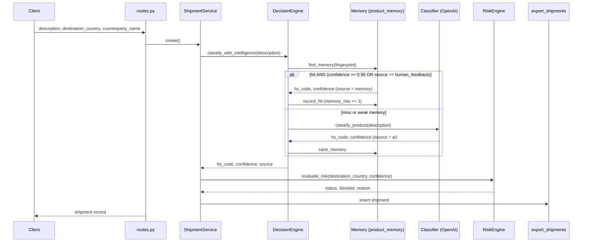

# Architecture

Export Agent is a single FastAPI service backed by PostgreSQL. It takes an export
shipment, assigns it an HS (Harmonized System) code, and returns a compliance
decision: `approved`, `review`, or `blocked`.

## Components

| Component | File | Responsibility |
|---|---|---|
| API | `backend/app/api/routes.py` | `POST /shipments`, `GET /shipments`, `POST /feedback`; one DB session per request |
| App / startup | `backend/app/main.py` | Creates tables on startup (`create_all`), exposes `GET /health` |
| Shipment service | `backend/app/services/shipment.py` | Orchestrates one shipment: classify → evaluate risk → persist |
| Decision engine | `backend/app/services/decision_engine.py` | Chooses between memory and the AI classifier |
| Memory | `backend/app/services/memory.py` | Stores/looks up past classifications by fingerprint (SHA-256 of the lower-cased, trimmed description) |
| Classifier | `backend/app/services/classifier.py` | Calls OpenAI `gpt-4o-mini`, extracts an `XXXX.XX` code with a regex; falls back to fixed values without a key or on error |
| Risk engine | `backend/app/services/risk_engine.py` | Pure function: sanctioned destination → block; confidence < 0.75 → review; otherwise approve |
| Feedback | `backend/app/services/feedback_service.py` | Writes a human-corrected HS code into memory with confidence 1.0 |
| Persistence | `backend/app/core/database.py`, `backend/app/models/models.py` | Async SQLAlchemy engine; tables `export_shipments`, `product_memory` |

## Data flow

### `POST /shipments`

### `POST /feedback`

The description is fingerprinted. An existing memory row is overwritten (or a new
one created) with the given HS code, `confidence = 1.0`, `source = human_feedback`.
Because human-feedback rows are always trusted by the decision engine, the next
shipment with the same (case/whitespace-normalised) description skips the AI call.

## Key decisions

- **Risk rules are separate from classification.** `evaluate_risk` is a pure function
  with no I/O, so policy can be read and tested in isolation from the AI.
- **Memory is keyed by an exact fingerprint**, not by similarity. This is cheap and
  deterministic, but "electric motor" and "electric motors" are different keys.
- **Memory trust threshold of 0.95.** AI results are stored with confidence 0.9, which
  is below this threshold, so in practice AI results are recorded but not reused;
  only human feedback (1.0) short-circuits the AI.
- **Graceful degradation.** With no `OPENAI_API_KEY` the classifier returns
  `8501.10` at 0.82 (which the risk engine approves); on an API error it returns
  `8501.10` at 0.5 (which goes to review). This keeps the service runnable offline.
- **Schema via `create_all` at startup**, no migrations. Simple for a prototype;
  schema changes require dropping tables.
- **Async throughout** (FastAPI + async SQLAlchemy + asyncpg + `AsyncOpenAI`).

## Testing approach

`backend/tests/` runs without Postgres, network access, or an API key:
the OpenAI client is replaced with mocks, and the database is in-memory SQLite
(via `aiosqlite`). API tests use httpx's `ASGITransport` with the DB dependency
overridden, so the Postgres-connecting startup hook never runs.
